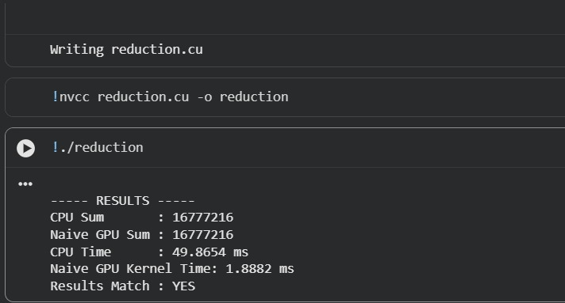
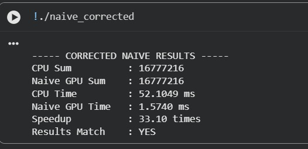
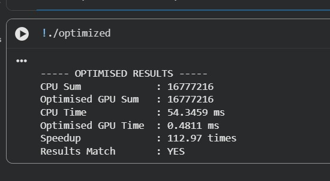
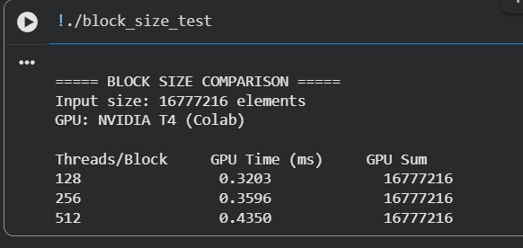
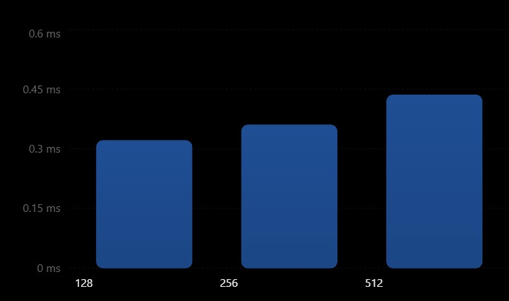

# CUDA Parallel Reduction using CUDA

## 1. Project Overview

This project implements **Parallel Reduction using CUDA** to calculate the sum of a large array of floating-point numbers using GPU parallel processing.

The project compares a Naive Reduction approach with an Optimised Reduction approach and analyses the performance of different CUDA block sizes.

## 2. Objectives

- Understand the concept of Parallel Reduction.
- Implement Naive Reduction using CUDA.
- Implement Optimised Reduction using CUDA.
- Compare CPU and GPU execution times.
- Analyse the effect of different block sizes on GPU performance.
- Verify the correctness of GPU results with CPU results.

## 3. Technologies Used

- CUDA C/C++
- NVIDIA CUDA Toolkit 13.0
- Google Colab
- NVIDIA Tesla T4 GPU

## 4. Input Details

| Parameter | Value |
|---|---|
| Input size | 16,777,216 elements |
| Input values | All values are 1.0 |
| Expected sum | 16,777,216 |
| Input array size | 64 MiB |
| GPU | NVIDIA Tesla T4 |

## 5. Implementations

### A. Naive Parallel Reduction

- Uses interleaved addressing.
- Uses shared memory to store intermediate sums.
- Performs reduction in multiple stages.
- Uses thread synchronization.

### B. Optimised Parallel Reduction

The optimised implementation uses:

- First addition during data loading.
- Sequential addressing.
- Warp shuffle using `__shfl_down_sync()`.
- Shared memory and synchronization for reduction stages.

These optimisations reduce unnecessary operations and improve GPU execution performance.

### C. Block Size Comparison

The optimised reduction was tested using three different block sizes:

- 128 threads
- 256 threads
- 512 threads

## 6. Performance Comparison

| Implementation | CPU Time (ms) | GPU Time (ms) | Speedup |
|---|---:|---:|---:|
| Naive Reduction (corrected) | 52.1049 | 1.5740 | 33.10x |
| Optimised Reduction | 54.3459 | 0.4811 | 112.97x |

**Result Verification:** All implementations produced the expected sum of **16,777,216**.

## 7. Estimated Memory Bandwidth

| Implementation | Estimated Bandwidth |
|---|---:|
| Naive Reduction | 42.63 GB/s |
| Optimised Reduction | 139.50 GB/s |

*Note: Bandwidth is estimated using the 64 MiB input size divided by GPU execution time. It is not the total memory traffic because intermediate partial sums also involve memory operations.*

## 8. Block Size Performance Analysis

| Threads per Block | GPU Time (ms) | GPU Sum |
|---:|---:|---:|
| 128 | 0.3203 | 16,777,216 |
| 256 | 0.3596 | 16,777,216 |
| 512 | 0.4350 | 16,777,216 |

**Observation:** 128 threads per block achieved the lowest execution time of 0.3203 ms among the three tested configurations.

## 9. Execution Results and Screenshots

### Naive Reduction – Initial Execution

### Naive Reduction – Corrected Full-GPU Execution

### Optimised Reduction

### Block Size Comparison

### Block Size Performance Graph

## 10. Applications

Parallel Reduction is useful in:

- Calculating loss values in Deep Learning.
- Computing vector norms.
- Calculating averages and sums.
- Statistical calculations.
- Processing large datasets on GPUs.

## 11. Conclusion

The project demonstrates Parallel Reduction using CUDA and compares Naive and Optimised GPU implementations.

The optimised implementation achieved a lower execution time than the corrected naive implementation. The block size experiment showed that 128 threads per block performed best among the tested configurations.

All GPU results matched the expected CPU sum, confirming the correctness of the implementation.

## 12. Repository Files

- `naive_corrected.cu` – Corrected Naive Reduction implementation.
- `block_size_test.cu` – Optimised reduction and block-size comparison.
- `PGC.ipynb` – Google Colab notebook containing the practical work and execution outputs.
- Result screenshots – Execution outputs and performance graph.
